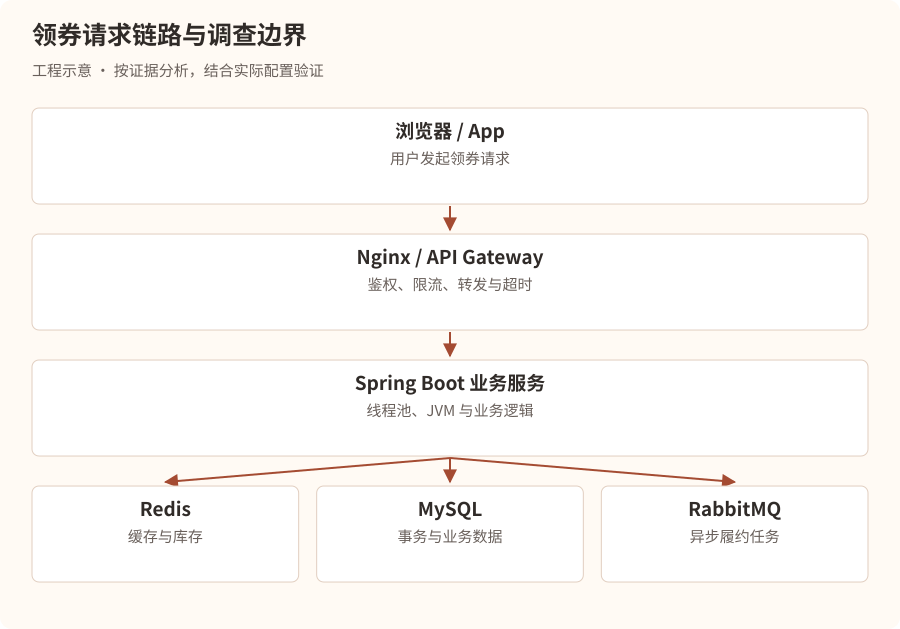
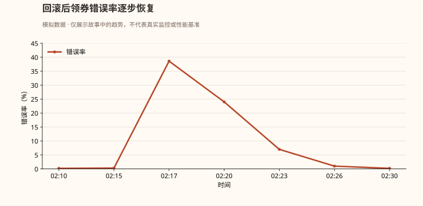

# 凌晨两点，服务器突然失联

## 第一幕：一条来自生产环境的警报

凌晨 2:17。

星海科技总部，二十三楼。

整个研发中心已经空无一人，只有服务器机房的散热风扇还在持续轰鸣。

突然，一条告警打破了寂静。

### 事故快照 · 虚构场景

| 项目 | 观测值 |
| --- | --- |
| 等级与时间 | P1 · 2026-10-16 02:17:34 |
| 服务 | benefit-service-prod |
| 错误率 | 38.6% |
| P99 延迟 | 12.8s |
| CPU | 96% |
| 异常 | HTTP 500 / 504 激增，实例健康检查失败 |

值班工程师林川被手机震醒。

他刚入职三个月，主要负责公司基于 Spring Boot、MySQL、Redis 和 RabbitMQ 构建的营销权益发放系统。

手机再次震动。

技术负责人陈默发来消息：

“林川，生产出问题了。用户领不了优惠券，你先看一下。”

林川迅速打开电脑。

监控显示，原本稳定在每秒 800 次请求的系统，突然出现了大量超时。

他第一反应是：

“是不是服务器 CPU 太高了？要不要重启？”

陈默立即回复：

“你连 CPU 为什么高都不知道，就准备重启？”

“可是系统已经快不能用了。”

“那你告诉我，重启能解决什么问题？”

林川沉默了。

陈默继续说道：

“记住，线上事故最危险的不是系统宕机，而是工程师在不知道原因的时候，随意操作生产环境。”

“现在，我教你第一件事。”

“先判断故障范围，再止血，保留证据，最后定位根因。不要把排查顺序搞反。”

## 第二幕：第一条线索——到底是谁出了问题？

陈默打开监控平台。

“林川，假设用户反馈领券失败，你会怀疑哪里？”

林川思考片刻：

“可能是前端，也可能是网关、Java 服务、Redis、MySQL，甚至 RabbitMQ。”

“没错。那你怎么判断？”

陈默在白板上画出整条请求链路。



“现在假设 Nginx 记录大量 504，你能确定 Java 服务 CPU 有问题吗？”

“不能。504 只能说明网关在规定时间内没有等到上游的有效响应。”

“对。它可能是 Java 服务处理太慢，也可能是网络异常、连接建立失败、依赖阻塞等。”

陈默补充：

“还有一点，HTTP 500 和 504 不一定来自同一个故障点。 你必须结合网关日志、应用日志和链路追踪分析。”

### 第一轮排查：判断影响范围

陈默要求林川先回答四个问题：

1. 是所有用户失败，还是部分用户失败？
2. 是所有接口失败，还是只有领券接口失败？
3. 是所有实例异常，还是某一个实例异常？
4. 是突然发生，还是随着流量增加逐渐恶化？

林川查看监控，发现：

- 登录、查询商品等接口基本正常。
- 领券接口错误率大幅上升。
- 三个业务实例中有两个 CPU 接近 100%。
- 故障发生前五分钟，领券服务刚刚发布过新版本。

林川眼睛一亮。

“难道是新版本有 Bug？”

陈默摇头。

“新版本是重要线索，但时间相关不等于因果关系。先看发布前后差异。”

他们核对了发布记录，发现新版本引入了一个营销资格计算逻辑。

但此时系统还在不断报错。

“先止血。”陈默说。

他们确认旧版本兼容当前数据库结构、没有不可逆数据迁移后，通过发布平台将流量切回上一稳定版本，并逐步摘除异常实例。

几分钟后，错误率开始下降。



“系统恢复了。”林川长出一口气。

“但事故还没结束。”陈默说，“我们还不知道为什么。”

## 第三幕：CPU 100%，就一定是死循环吗？

陈默拿出刚才保留的 JVM 线程快照。

“假设我们在故障发生时登录到 Linux 服务器，你第一步会执行什么？”

林川回答：

```
top
```

屏幕显示：

```
PID     USER    %CPU   %MEM   COMMAND
18432   app     195.3  18.2   java
```

林川愣住了。

“CPU 不是最高 100% 吗？怎么会有 195%？”

陈默笑了笑。

“在 Linux 常见的 `top` 显示模式下，进程 CPU 使用率可以超过 100%，因为一个进程可能同时使用多个 CPU 核心。”

“195% 大致相当于使用了接近两个逻辑 CPU 核心的计算能力。”

“但注意，这还不能说明一定是 Java 业务代码的问题。”

“可能是频繁 GC、死循环、热点计算、序列化开销，也可能是其他原因。”

“所以，我们需要继续往下查。”

#### 第一步：找到 Java 进程

```
jps -l
```

假设输出：

```
18432 com.xinghai.BenefitApplication
```

#### 第二步：查看进程内的高 CPU 线程

```
top -H -p 18432
```

林川看到：

```
PID     %CPU   COMMAND
18479   98.7   java
18483   91.2   java
18491    2.1   java
```

“18479 和 18483 这两个线程很可疑！”

“对。但现在我们只知道线程 ID，不知道它们执行了什么 Java 代码。”

“怎么办？”

“把线程 ID 转换成十六进制。”

```
printf '%x\n' 18479
```

输出：

```
482f
```

“为什么要转十六进制？”

“因为 HotSpot JVM 的线程 dump 通常使用十六进制 `nid` 表示操作系统原生线程 ID。”

#### 第三步：抓取线程栈

```
jcmd 18432 Thread.print -l > /tmp/thread.txt
```

然后搜索：

```
grep -A 35 'nid=0x482f' /tmp/thread.txt
```

屏幕上出现：

```
"coupon-worker-7" #85
   java.lang.Thread.State: RUNNABLE
    at com.xinghai.rule.RuleEngine.calculate(...)
    at com.xinghai.coupon.CouponService.check(...)
    at com.xinghai.coupon.CouponController.receive(...)
```

林川兴奋地说道：

“找到凶手了！RuleEngine！”

陈默却摇头。

“还不能确定。”

“为什么？”

“因为 `RUNNABLE` 只是 JVM 线程状态，单次线程栈也只能说明采样瞬间它正在执行这段代码。”

“我们要连续采样，看它是不是一直停留在同一段计算逻辑里。”

于是，他们间隔几秒抓取了多份线程快照。

结果发现，两条高 CPU 线程反复出现在同一个规则计算方法中。

而 GC 指标没有显示异常增长。

“现在我们才有比较充分的理由怀疑业务代码热点。”

## 第四幕：隐藏在循环里的杀手

林川打开刚刚上线的规则计算代码。

```
public int calculate(List<Integer> scores) {
    int result = 0;

    for (int i = 0; i < scores.size(); i++) {
        for (int j = 0; j < scores.size(); j++) {
            result += Math.abs(scores.get(i) - scores.get(j));
        }
    }

    return result;
}
```

“这段代码有什么问题？”陈默问。

“嵌套循环，时间复杂度 O(n²)。”

“那它一定有问题吗？”

“不一定。如果 scores 只有十个元素，执行一百次计算，问题不大。”

“很好。那如果有一万个元素呢？”

林川迅速计算。

**10,000 × 10,000 = 100,000,000**

“一亿次！”

“而且如果有大量用户并发请求，多个线程就会同时执行这些计算。”

“这才是 CPU 被打满的原因。”

陈默继续解释：

“以前的版本只对少量固定规则评分。新版本把用户历史行为全部传了进来，部分用户的集合达到了上万个元素。”

“算法复杂度从可以忽略，变成了整个服务的性能瓶颈。”

> **工程补充**：示例保留了事故代码。除了二次复杂度，还要检查整数溢出：两个 int 相减和累加都可能溢出，Math.abs(Integer.MIN_VALUE) 也不会得到正数。修复时应在相减前提升数值类型，并按输入范围验证总和是否超出 long；若列表不是随机访问实现，重复 get 还会增加开销。


林川问：

“那是不是把服务器扩容就行？”

“扩容可以缓解，但未必解决。”

“假设单次请求耗费大量 CPU，扩容可能暂时增加吞吐量，但如果流量继续增长，问题仍会出现。更重要的是，这段算法本身是否能优化？”

他们重新分析需求，发现根本不需要计算所有元素对之间的绝对差。

对于排序后的数组 `a₀ ≤ a₁ ≤ … ≤ aₙ₋₁`，可以利用每个元素对总和的贡献，将原来的二次复杂度优化为排序主导的 `O(n log n)`。

但陈默没有立刻把优化代码提交生产。

“先补边界测试、压测和性能基准，再走灰度发布。”

“因为我们解决的是线上事故，不是一道只要求通过样例的算法题。”

## 第五幕：真正的线上排查方法论

凌晨 4:12。

故障复盘会议开始。

陈默在白板上写下八个字：

现象 → 范围 → 止血 → 根因

接着，他补充了完整流程。

1. 发现异常

   通过错误率、P95/P99 延迟、吞吐量、资源使用率发现故障
2. 确定故障范围

   按用户、接口、实例、机房、版本、时间维度缩小范围
3. 安全止血

   回滚、限流、降级、熔断、切流或扩容；优先选择可逆操作
4. 保留现场证据

   保存日志、线程栈、GC 指标、Trace、数据库与中间件状态
5. 提出并验证假设

   根据证据排除错误方向，不凭单一指标下结论
6. 修复并验证

   测试环境复现、压测、灰度、监控验证，必要时回滚
7. 事故复盘

   补充测试、告警、容量规划和应急预案，避免再次发生

陈默最后问：

“林川，你现在还觉得线上 CPU 100%，直接重启就可以了吗？”

“不觉得了。”

“说说为什么。”

“因为 CPU 高只是现象，可能是业务计算、GC、线程竞争等原因。重启可能暂时恢复，但也可能销毁关键现场，而且问题可能很快再次出现。”

“如果业务影响严重，应优先通过可控方式止血，同时尽量保存证据。之后再结合 CPU、线程栈、GC、发布记录和调用链定位根因。”

陈默点点头。

“这才是生产环境工程师的思维方式。”

## 本章技术档案：CPU 异常排查速查

| 现象             | 重点怀疑             | 排查手段                  |
| -------------- | ---------------- | --------------------- |
| CPU 高，少数线程持续繁忙 | 死循环、热点计算         | `top -H`、线程栈、Profiler |
| CPU 高，GC 次数频繁  | 对象分配过快、堆压力       | `jstat`、GC 日志、JFR     |
| CPU 不高，请求却很慢   | I/O 阻塞、锁等待、连接池耗尽 | 线程栈、Trace、连接池指标       |
| CPU 高，吞吐量下降    | GC、锁竞争、计算瓶颈      | CPU/GC/线程联合分析         |
| 只有个别实例异常       | 流量倾斜、实例配置、局部故障   | 实例对比、负载均衡指标           |

注意：生产排查命令应在具备权限、遵循操作规范的情况下执行。线程 dump、Profiler、Heap Dump 都可能产生开销，尤其需要注意磁盘空间、敏感数据和高负载实例。

### 面试官突然出现

第二天上午，陈默扮演面试官。

“假设线上 Java 服务 CPU 突然达到 100%，你会怎么排查？”

林川回答：

“我会先判断影响范围和业务严重程度，结合监控确定是否需要限流、切流或回滚止血。

然后通过 `top` 判断是哪个进程占用 CPU，通过 `top -H -p PID` 找到高 CPU 线程，将线程 ID 转为十六进制，结合 `jcmd Thread.print` 或线程 dump 定位对应 Java 调用栈。

如果线程持续执行某段业务逻辑，我会重点排查死循环、算法复杂度和热点计算；如果 GC 指标异常，则进一步查看 GC 日志、堆使用情况和对象分配速率。

定位原因后，在测试环境复现并验证修复方案，灰度发布，观察 CPU、吞吐量、延迟和错误率是否恢复，最后完成事故复盘。”

陈默说：

“这个回答已经具备了完整的排查逻辑。但真正的难点在于，你能不能根据现场证据判断下一步应该查什么，而不是机械地背命令。”

## 后续章节规划 · 尚未发布

这部小说会逐渐从单机故障深入到完整的分布式系统事故。

| 章节   | 事故主题              | 核心技术                                  |
| ---- | ----------------- | ------------------------------------- |
| 第二章  | 消失的内存：服务器为什么越跑越慢？ | JVM 内存泄漏、OOM、Heap Dump、MAT            |
| 第三章  | 被困住的线程：接口突然全部超时   | 线程池、锁竞争、死锁、连接池                        |
| 第四章  | 数据库的死亡倒计时         | MySQL 慢 SQL、索引失效、执行计划                 |
| 第五章  | 一场无法提交的事务         | 行锁、间隙锁、死锁、MVCC                        |
| 第六章  | Redis 帝国的雪崩       | 缓存穿透、击穿、雪崩、热 Key                      |
| 第七章  | 消失的十万张优惠券         | RabbitMQ 消息丢失、重复消费、积压                 |
| 第八章  | 504 风暴：谁偷走了响应时间？  | TCP、连接池、Nginx、超时链路                    |
| 第九章  | JVM 的停顿：消失的三秒钟    | GC、STW、G1、ZGC                         |
| 第十章  | 流量洪峰：十万请求同时抵达     | 限流、熔断、降级、容量规划                         |
| 第十一章 | 幽灵订单：数据为何不一致？     | 分布式事务、幂等、补偿、最终一致性                     |
| 第十二章 | 看不见的凶手：生产事故终极调查   | Prometheus、Grafana、Tracing、Arthas、JFR |

### 下一章：消失的内存——16GB 的服务器为什么还是 OOM 了？

故事将从一次诡异的生产事故开始：服务器拥有 16GB 内存，JVM 最大堆设置为 8GB，监控显示堆内存似乎还有空间，Java 进程却突然被 Linux 杀死。

我们将随着林川的调查，逐步揭开 Java Heap OOM、Metaspace OOM、Direct Memory OOM、容器 OOMKilled、Linux OOM Killer、内存泄漏与内存溢出的区别，以及如何使用 `jcmd`、`jmap`、MAT、GC 日志和 Arthas 找出真正的问题。
