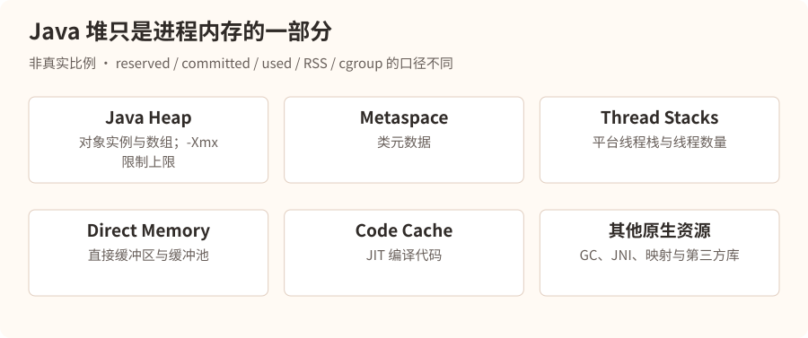
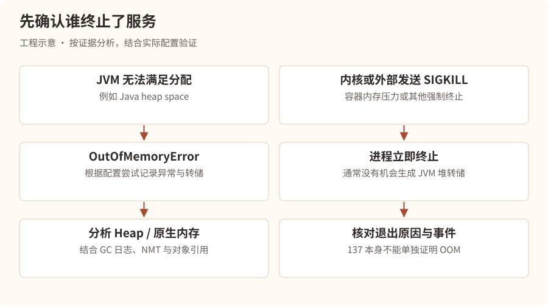
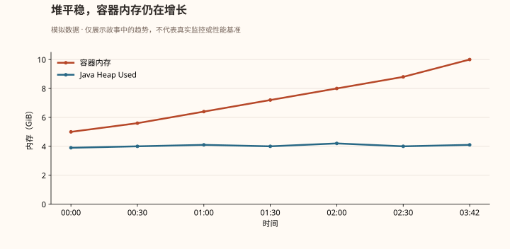
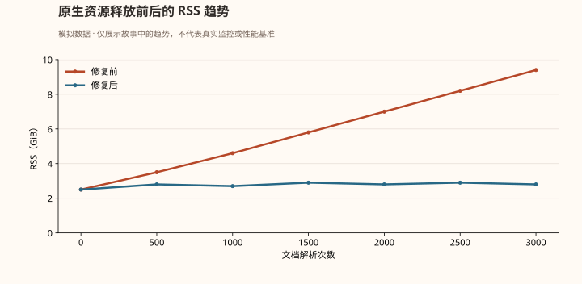
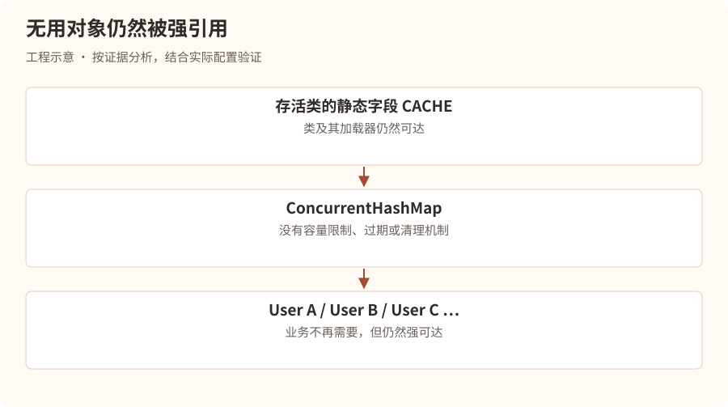

# 消失的内存——16GB 的服务器为什么还是 OOM 了？

## 第一幕：一台被 Linux 判处死刑的服务器

凌晨 3:42。

星海科技研发中心。

林川刚刚结束上一场 CPU 事故的复盘，原本以为终于可以安稳睡觉。

突然，手机再次响起。

### 事故快照 · 虚构场景

| 项目 | 观测值 |
| --- | --- |
| 等级与服务 | P1 · rag-service-prod-02 |
| 时间 | 03:42:17 |
| 宿主机内存 | 16GB |
| JVM 最大堆 | 8GiB（-Xmx8g） |
| 退出码 | 137 |
| 异常 | 进程突然消失，无 Java OutOfMemoryError 日志 |

林川看着监控，皱起眉头。

“奇怪，服务器有 16GB 内存，我给 JVM 配置了 `-Xmx8g`，按理说还有 8GB 留给系统。”

“为什么会内存不足？”

电话另一端，技术负责人陈默沉默了几秒。

“林川，你是不是认为 JVM 最大堆内存等于 Java 进程最大内存？”

“难道不是？”

“当然不是。”

“那 `-Xmx8g` 到底限制了什么？”

“只限制 Java 堆的最大容量，不是整个 JVM 进程的内存上限。”

陈默打开远程会议。

“今晚，我带你认识一个比 CPU 100% 更隐蔽的敌人。”

“内存。”

## 第二幕：内存王国——JVM 到底占用了多少内存？

陈默在白板上画了一座城市。

“你可以把 JVM 想象成一座城市。”

“Java 堆只是城市里最大的一片住宅区。”

“但城市不可能只有住宅区。”

“还需要道路、仓库、行政中心、工厂，以及工人自己的休息空间。”

林川点点头。

“也就是说，Java 进程除了堆，还有其他内存开销？”

“对。”

### JVM 进程的内存版图



进程的 RSS、虚拟内存和 JVM 各内存区域不是简单的一一对应关系，不能把配置上限之和当作实际物理内存。

陈默解释：

“Java 进程可能消耗的内存，包括堆、元空间、线程栈、直接内存、JIT 代码缓存、GC 数据结构和其他原生内存。”

“因此，即使堆内存没有达到 8GB，整个进程仍然可能超过操作系统或容器的内存限制。”

林川突然想到：

“那我是不是只要把 `-Xmx` 设置小一点，就能解决？”

“未必。”

“为什么？”

“因为你还不知道内存究竟消耗在哪里。”

“如果是线程数量异常，降低堆大小不一定有用。”

“如果是 Direct Memory 不断增长，降低堆大小可能只是给它暂时腾出空间。”

“如果是容器限制太小，还可能需要重新规划整个内存预算。”

陈默在白板上写下：

**进程内存使用量 ≠ Java Heap 使用量**

“这是今天你必须记住的第一件事。”

## 第三幕：137 号死亡通知书

林川翻阅应用日志。

最后一条日志停留在：

```
03:42:16 INFO  DocumentParser
Parsing document: handbook-2026.pdf
```

随后，没有异常堆栈，没有 `OutOfMemoryError`，进程直接消失。

“为什么没有 Java 异常？”

陈默问：

“如果 JVM 自己发现 Java 堆空间不足，会发生什么？”

“通常抛出 `java.lang.OutOfMemoryError`。”

“那如果是 Linux 内核直接杀死进程呢？”

林川愣住了。

“JVM 根本没有机会抛异常？”

“没错。”

### 两种完全不同的死亡方式

陈默画了两条路径。



“所以，137 代表什么？”陈默问。

林川回答：

“通常是 128 + 9，也就是进程因 SIGKILL 终止。”

“很好。但要注意，退出码 137 不能单独证明发生了 OOM。 管理员执行 `kill -9`，或者其他机制发送 SIGKILL，也可能出现 137。”

“我们必须继续寻找证据。”

#### 第一步：检查容器退出原因

假设服务运行在 Kubernetes 中：

```
kubectl describe pod rag-service-xxx
```

林川看到：

```
Last State:
  Terminated:
    Reason: OOMKilled
    Exit Code: 137
```

“这下可以确定了！”

“基本可以确认该容器被判定为 OOMKilled。但我们仍然需要弄清楚具体的内存压力来源。”

#### 第二步：查看容器资源限制

```
kubectl get pod rag-service-xxx -o yaml
```

关键配置：

```
resources:
  requests:
    memory: "4Gi"
  limits:
    memory: "10Gi"
```

林川突然发现了问题。

“服务器虽然有 16GB，但容器的内存限制只有 10Gi！”

“对。容器能使用的内存，并不直接等于宿主机物理内存。”

陈默继续说道：

“`requests.memory` 主要用于调度与资源保障相关机制；`limits.memory` 才是这里需要重点关注的内存上限。”

“所以，我们应该以容器的 10Gi 为基础制定 JVM 内存预算，而不是宿主机的 16GB。”

### 一个危险的内存配置

| 事故配置 | 内存预算 |
| --- | --- |
| 容器上限 | 10GiB |
| 堆上限 | 8GiB |
| 其他区域与余量 | 2GiB |

堆上限占容器限制的 80%，剩余预算是否足够需要实测。

“但是，”林川问，“我们现在只是发现配置有风险，仍然不知道究竟是什么吃掉了内存。”

“正确。”

陈默打开了另一张监控图。

## 第四幕：不断膨胀的幽灵

监控数据显示：



林川盯着屏幕。

“Java 堆一直只有 4GB 左右，但是容器内存从 5GB 一直涨到 10GB。”

“说明什么？”

“说明内存增长可能主要发生在堆外。”

“没错。不过这里还有一个细节。”

“什么？”

“容器内存指标可能包含文件页缓存等内容，和进程 RSS 不是同一个概念。所以不能仅凭这张图就认定 Direct Memory 泄漏。”

陈默决定进一步调查。

“我们需要区分三类证据：JVM 内部统计、进程内存，以及容器 cgroup 统计。”

> **工程补充**：事故进程已退出，无法再对它执行 jcmd 或读取其 /proc。下文的在线检查来自尚存活的同版本实例和受控复现实验；事后分析同时使用事先采集的指标、容器退出记录与内核事件。命令中的 PID 只是占位示例。

### 第一件武器：Native Memory Tracking

陈默问：

“你知道 JVM 自带一个叫 NMT 的工具吗？”

“不知道。”

“全称 Native Memory Tracking，可以跟踪 HotSpot JVM 自身管理的多类原生内存分配。”

“不过有两个限制：需要在 JVM 启动时启用，而且它不能完整覆盖所有第三方原生库和所有内存映射。”

他们检查了事故实例的启动配置。

```
-XX:NativeMemoryTracking=summary
```

“幸好这个服务之前就启用了 NMT。”

陈默解释：

“如果没有提前启用，不能指望在进程运行中直接开启完整的 NMT 跟踪。我们需要通过新实例或下次启动启用。”

查看统计：

```
jcmd 18432 VM.native_memory summary scale=MB
```

以下为合并其他类别后的教学输出，数值用于说明 reserved、committed 与 used 的区别，不是逐字复制的 NMT 日志：

```
Native Memory Tracking:

Total: reserved=13500MB, committed=9100MB

- Java Heap
    reserved=8192MB, committed=8192MB

- Class
    reserved=1050MB, committed=180MB

- Thread
    reserved=1300MB, committed=125MB

- Code
    reserved=250MB, committed=95MB

- Other categories (combined for illustration)
    reserved=2708MB, committed=508MB
```

林川发现：

“为什么 Java Heap committed 是 8192MB，但监控中使用量只有 4GB？”

陈默解释：

“因为 committed 和 used 不是同一个概念。”

“committed 代表 JVM 已向操作系统提交的内存容量，而堆 used 代表当前堆中已使用的容量。”

“而且 committed 也不能直接等同于实际 RSS。”

“那 reserved 呢？”

“reserved 通常表示保留的虚拟地址空间，不代表已经占用了等量物理内存。”

陈默在白板上写下：

| 指标            | 含义                   |
| ------------- | -------------------- |
| Reserved      | 预留的虚拟地址空间            |
| Committed     | 已提交的内存容量             |
| Heap Used     | 堆中当前已使用的空间           |
| RSS           | 进程实际驻留在物理内存中的页面量     |
| Cgroup Memory | 容器所属 cgroup 计费的内存使用量 |

“这些指标口径不同，不能混为一谈。”

林川问：

“可是 NMT 没发现特别明显的增长，怎么办？”

陈默回答：

“这反而是一条线索。”

“如果 JVM 自己跟踪的原生内存变化不大，但进程 RSS 持续增长，就需要怀疑 NMT 覆盖不到的原生分配或内存映射。”

“接下来查操作系统。”

### 第二件武器：进程内存

```
cat /proc/18432/status
```

重点关注：

```
VmRSS:
VmSize:
Threads:
```

也可以查看：

```
cat /proc/18432/smaps_rollup
```

以及：

```
pmap -x 18432
```

陈默补充：

“如果是容器，还要查看 cgroup v2 的 `memory.current`、`memory.stat` 和 `memory.events` 等指标。”

“不同容器运行时、cgroup 版本、权限和命名空间下，路径可能不同。”

林川追问：

“所以我们需要对比 JVM 内存、进程 RSS 和容器内存三条曲线？”

“对。这样才能判断内存到底是被 JVM、原生库，还是文件缓存等其他部分消耗。”

## 第五幕：真正的凶手——被遗忘的 PDF 页面

凌晨 5:06。

林川终于找到了异常代码。

服务负责解析企业上传的 PDF 文档，再将文本切分并写入向量数据库。

某个开发人员为了提高解析性能，引入了一个原生 PDF 渲染库。

代码经过简化后类似：

```
public void parsePdf(String path) {
    NativePdfDocument document =
        NativePdfDocument.open(path);

    for (int i = 0; i < document.pageCount(); i++) {
        NativePdfPage page = document.loadPage(i);

        String text = page.extractText();
        saveText(text);
    }
}
```

林川看了半天。

“这有什么问题？”

陈默指向 `NativePdfPage`。

“它是什么？”

“一个 Java 对象。”

“它背后呢？”

“可能对应原生 PDF 页面资源。”

“那么当 Java 对象不可达的时候，原生资源就一定立即释放了吗？”

林川愣住了。

“不一定。”

“没错。某些原生库要求调用者显式关闭或释放底层资源。”

“如果只依赖 Java GC，而没有按照库的资源管理协议释放原生对象，内存就可能不断累积。”

陈默展示了修复后的伪代码：

```
public void parsePdf(String path) {
    try (NativePdfDocument document =
             NativePdfDocument.open(path)) {

        for (int i = 0; i < document.pageCount(); i++) {
            try (NativePdfPage page =
                     document.loadPage(i)) {

                String text = page.extractText();
                saveText(text);
            }
        }
    }
}
```

这里的 NativePdfDocument、NativePdfPage 是用于讲解的虚构接口，假设它们实现 AutoCloseable。实际使用时必须遵循对应 PDF 库的释放规范。

“原来如此！”林川说道。

“Java 堆中的对象可能被 GC 回收，但是底层原生资源未必按照预期释放。”

“正是这样。”

### 为什么 GC 没能拯救服务器？

陈默进一步解释：

“GC 主要依据 Java 对象的可达性和堆内存压力工作。”

“但某些原生内存分配不会完整地反映在 Java 堆的使用量里。”

“因此可能出现这样一种情况：”

- Java 堆使用量长期稳定。
- 原生内存持续增加。
- JVM 没有明显的堆空间压力。
- 容器内存逐渐触及限制。
- 最终被 OOM Killer 终止。

“当然，这不意味着所有堆外内存都不受 GC 影响。”陈默补充，“例如某些直接缓冲区具有与 Java 对象生命周期关联的清理机制，但释放时机和实现细节需要具体分析。”

“这次的关键是，我们使用的原生库要求显式释放资源，而代码没有做到。”

### 如何证明修复有效？

林川提出：

“我们把 `close()` 加上，然后发布不就行了？”

陈默摇头。

“你怎么证明这就是根因？”

他们做了一个可控的复现实验。

首先，在测试环境中使用固定的 PDF 文件集，连续解析数千次。

记录进程 RSS、容器内存、JVM Heap 和 NMT 数据。

然后分别运行旧版本和修复版本。



“修复后 RSS 没有持续增长！”林川说道。

“这才是更有力的证据。”

“还需要检查资源释放是否影响解析正确性、异常分支是否也能关闭资源，以及并发解析时是否仍然稳定。”

“然后再灰度发布。”

陈默关闭监控页面。

“这次我们不仅修好了代码，还要重新设计容器内存预算，并给原生内存增长增加告警。”

## 第六幕：另一个世界——如果真的是 Java Heap OOM 呢？

天亮以后，林川以为课程结束了。

陈默却打开了一份新的事故档案。

“刚才是原生内存问题。”

“但 Java 面试官更喜欢问另一种情况。”

“如果出现 `java.lang.OutOfMemoryError: Java heap space`，你该怎么办？”

林川回答：

“把 `-Xmx` 调大？”

陈默看了他一眼。

“你又想直接扩容了。”

“……”

“假设你的服务每小时泄漏 500MB 内存，8GB 堆撑不住，换成 16GB 堆就不会泄漏了吗？”

“还是会，只是死得更晚。”

“对。”

“所以你必须先理解什么叫内存泄漏。”

### 1. 内存溢出与内存泄漏的区别

陈默画了一个仓库。

“假设 Java 堆是一座仓库。”

“正常情况下，你往里面放货物，不需要的货物会被清理出去。”

“但有两种情况会让仓库爆满。”

第一种：仓库确实不够大。

例如业务需要同时处理一个 5GB 的数据集，但可用堆空间只有 2GB。

即使程序没有泄漏，也可能 OOM。

第二种：仓库里堆满了永远不会被清理的旧货。

例如某个静态集合不断保存用户对象，却从来不删除。

```
public class UserCache {

    private static final Map<Long, User> CACHE =
        new ConcurrentHashMap<>();

    public static void add(User user) {
        CACHE.put(user.getId(), user);
    }
}
```

“假设用户数量持续增加，而且缓存没有容量限制、过期或清理机制，会发生什么？”

“Map 会越来越大。”

“GC 能回收这些 User 吗？”

“不能，因为静态 Map 仍然持有它们的引用。”

“这就是典型的 Java 对象滞留问题，可能构成内存泄漏。”

### GC 为什么不回收这些对象？

陈默继续解释：

“垃圾回收器不是根据对象有没有业务价值来判断是否回收。”

“而是根据对象是否仍然可达。”

“只要存在从 GC Roots 到对象的引用路径，它就可能继续存活。”

例如：



只要仍然强可达，即使业务已经不需要这些对象，GC 也无法判断它们应被删除。

林川终于理解了。

“所以内存泄漏不一定是内存没有释放，而是对象已经没有业务价值，却仍然被引用着。”

“准确。”

“不过，注意 Java 的内存泄漏与 C/C++ 的典型内存泄漏表现可能不同。”

## 第七幕：Heap Dump——给内存拍一张尸检照片

“如果你怀疑 Java 堆内存泄漏，怎么找到具体对象？”

陈默问。

林川思考片刻：

“查看 Heap Dump？”

“没错。”

“Heap Dump 就像给 Java 堆拍一张快照，记录堆中对象及其引用关系。”

### 1. 提前配置 OOM 自动转储

```
-XX:+HeapDumpOnOutOfMemoryError
-XX:HeapDumpPath=/data/dumps
```

陈默提醒：

“这个参数很有用，但不是万能的。”

“如果是容器被内核直接 SIGKILL，通常不能指望 JVM 自动生成 Heap Dump。”

“而且 Dump 文件可能很大，可能包含用户数据、Token、密码等敏感信息，必须控制磁盘空间和访问权限。”

### 2. 手动生成 Heap Dump

```
jcmd <PID> GC.heap_dump /data/dumps/heap.hprof
```

“生产环境能随便执行吗？”林川问。

“不能。生成堆转储可能造成明显停顿、I/O 压力和额外内存开销。”

“应先评估实例负载、磁盘容量和业务影响，优先在可隔离实例或测试环境操作。”

“而且默认情况下，这类命令可能触发 Full GC；具体行为与 JDK 版本及参数有关。”

### 3. 使用 MAT 分析

陈默打开 Eclipse Memory Analyzer，简称 MAT。

“MAT 中有几个重要概念。”

| 概念               | 含义                        |
| ---------------- | ------------------------- |
| Histogram        | 按类统计对象数量和浅堆大小             |
| Dominator Tree   | 根据对象支配关系分析内存保留情况          |
| Shallow Heap     | 对象本身占用的堆空间                |
| Retained Heap    | 如果对象被移除，理论上可能释放的对象集合所占堆空间 |
| Path to GC Roots | 查找对象为什么仍然可达               |

林川看到：

```
Class                         Objects
-------------------------------------
java.util.concurrent.ConcurrentHashMap$Node  2,100,000
com.xinghai.User             1,800,000
byte[]                         950,000
java.lang.String             3,500,000
```

“User 对象这么多，是不是 User 泄漏？”

“不能直接这么判断。”

“对象数量多，可能是业务正常需求，也可能是异常滞留。”

“要结合 Retained Heap、GC Roots 引用链、对象生命周期和业务预期。”

他们打开 Dominator Tree。

发现：

```
UserCache.CACHE
  -> ConcurrentHashMap
      -> Node[]
          -> User
          -> User
          -> User
```

“这下找到根因了。”

陈默说道：

“更准确地说，我们找到了大量 User 对象被保留的引用链。”

“接下来还要核对：这个缓存是否应该长期保存这么多用户，以及为什么没有过期策略。”

## 第八幕：五种常见 OOM，五种不同的调查方向

陈默在会议室中放下五份档案。

“林川，线上内存事故不能只背 `Java heap space`。”

“不同类型的 OOM，排查方向完全不同。”

档案一：Java heap space

堆空间无法满足对象分配。重点检查大对象、对象滞留、缓存无限增长、内存配置不足。

工具：GC 日志、Heap Dump、MAT、JFR

档案二：Metaspace

类元数据相关的原生内存不足。重点检查动态类生成、ClassLoader 泄漏、反复热加载，以及元空间限制。

工具：jcmd VM.classloader_stats、NMT、类加载指标

档案三：Unable to create native thread

无法创建新的原生线程。可能是线程数过多、系统线程或进程限制、原生内存不足。

工具：线程数量、线程栈、ulimit、cgroup pids 指标

档案四：Direct buffer memory

直接缓冲区分配失败。重点检查 NIO/Netty 缓冲区、资源释放、缓冲区池以及直接内存限制。

工具：BufferPoolMXBean、JFR、NMT、框架泄漏检测

档案五：容器 OOMKilled

容器触及内存限制并被终止。重点检查容器内存、进程 RSS、堆与原生内存、文件缓存、cgroup 事件。

工具：kubectl describe、memory.stat、memory.events、进程指标

“所以，”陈默说，“看见 OOM 之后，第一件事不是盲目调大内存，而是确定 OOM 的类型。”

## 第九幕：生产事故中的实战决策

现在，陈默给林川一道现场题。

“假设你接到告警，Java 服务内存持续增长，最终 OOM。”

“你怎么排查？”

林川没有立即回答。

他先在纸上写下三个问题：

第一，谁报的 OOM？

是 JVM 抛出 `OutOfMemoryError`，还是容器 OOMKilled？

第二，哪里在增长？

是 Heap Used、进程 RSS、容器内存，还是某个具体原生内存区域？

第三，为什么增长？

是正常业务峰值、配置不足、对象滞留、原生资源泄漏，还是线程数量异常？

陈默说道：

“很好。现在我给你一套真实工作中可以参考的排查顺序。”

### 线上内存异常排查清单

1. 确认故障范围、OOM 类型与退出原因
2. 判断是否需要切流、回滚、限流或扩容止血
3. 检查容器限制、Heap Used、RSS 和内存趋势
4. 检查 GC 日志与对象分配速率
5. 针对 Heap OOM 分析 Heap Dump 与 GC Roots
6. 针对堆外增长分析 NMT、cgroup 和原生资源
7. 复现问题并验证修复方案
8. 灰度上线、观察指标并完成事故复盘

## 第十幕：面试官的最后一道题

上午 9:30。

陈默坐在会议室里。

“林川，现在你来回答一道 Java 后端面试题。”

“线上 Java 服务内存持续上涨，最终 OOM，你会怎么排查和解决？”

林川回答：

“我会按照故障分类、监控定位、现场分析、修复验证四个层次展开。”

“首先判断是 JVM 抛出的 OOM，还是操作系统或容器触发的 OOMKilled。如果是容器 OOMKilled，我会检查退出原因、容器内存限制、进程 RSS 和 cgroup 内存指标。”

“其次，我会查看 JVM 堆使用量、GC 次数、GC 停顿、Old Gen 使用趋势以及堆外内存情况，判断增长发生在哪个区域。”

“如果是 Java Heap OOM，我会分析 GC 日志和 Heap Dump，通过 MAT 的 Dominator Tree、Retained Heap 和 Path to GC Roots 找到异常保留的对象，并结合业务逻辑判断是否存在缓存无限增长、集合未清理或大对象问题。”

“如果是原生内存异常，我会结合 NMT、线程数量、直接缓冲区统计和进程内存映射，进一步检查 Direct Memory、线程栈、动态类加载或第三方原生库。”

“最后根据根因采取措施，例如修复对象滞留、释放原生资源、限制缓存容量、优化批处理或调整 JVM 和容器内存预算。修复后通过压测和灰度验证内存曲线是否恢复稳定。”

陈默问：

“如果面试官追问：为什么你不直接调大 `-Xmx`？”

林川回答：

“因为调大堆只能解决部分容量不足问题，不能消除内存泄漏，而且在容器内存固定的情况下，堆越大，留给原生内存的空间可能越少，反而增加 OOMKilled 风险。”

“很好。”

陈默合上电脑。

“现在你终于明白，为什么生产环境排查不能只会背几个 JVM 参数了。”

## 本章总结：真正需要记住的五件事

1. `-Xmx` 不是 Java 进程的内存上限。 堆外还有元空间、线程栈、直接内存、JVM 原生开销等。
2. OOM 不等于内存泄漏。 容量不足、大对象、突发流量和内存滞留都可能导致 OOM。
3. 137 不一定是 OOM。 必须结合容器状态和内核或 cgroup 证据。
4. Heap Dump 主要解决 Java 堆对象问题。 对原生内存增长，还需要 NMT、RSS、cgroup、JFR 等证据。
5. 修复的关键是找到持续增长的来源。 扩容可以止血，但不能替代根因分析。

## 下一章预告

## 第三章：《被困住的线程——接口突然全部超时》

某天上午 10:00，星海科技的 Java 服务突然出现大规模超时。

CPU 只有 15%，内存使用正常，MySQL 也没有明显异常，但所有业务请求都堵在了 Tomcat 中。

林川起初怀疑数据库慢查询，随后发现 200 个 Tomcat 工作线程全部处于等待状态，而真正的凶手竟然藏在一个看似普通的 `synchronized` 方法中。

下一章将通过这场事故，深入理解 Tomcat 线程池、BLOCKED/WAITING/TIMED_WAITING、Java 锁竞争、死锁、Thread Dump、数据库连接池耗尽、线程池饥饿，以及为什么 CPU 很低也能导致整个服务不可用。
