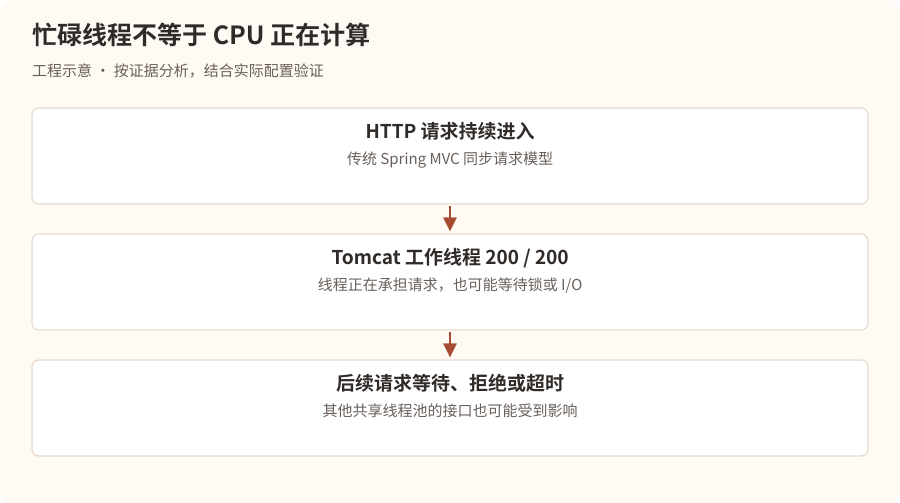
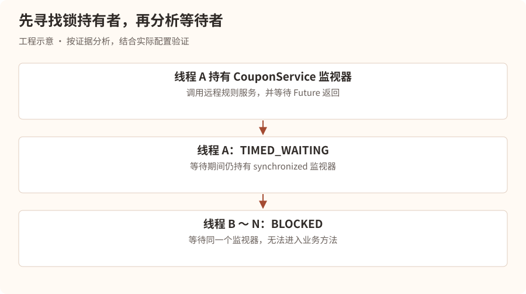
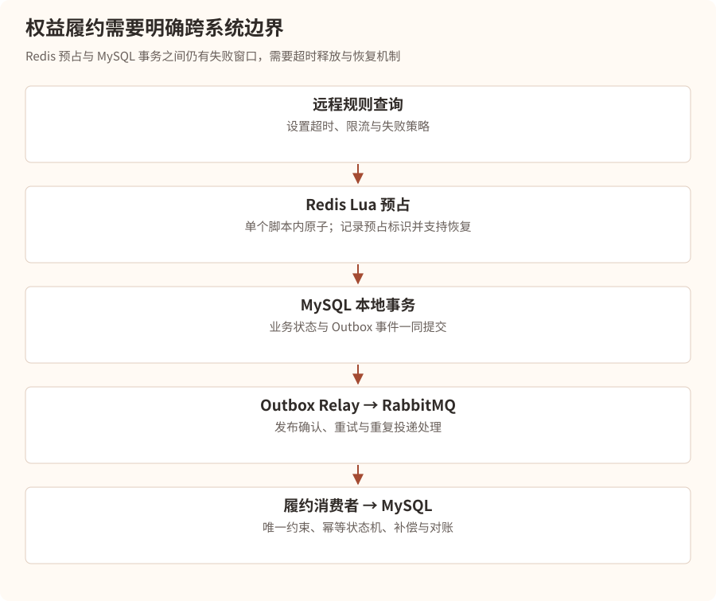
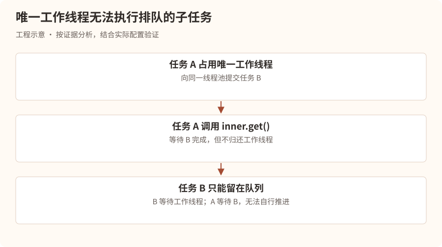
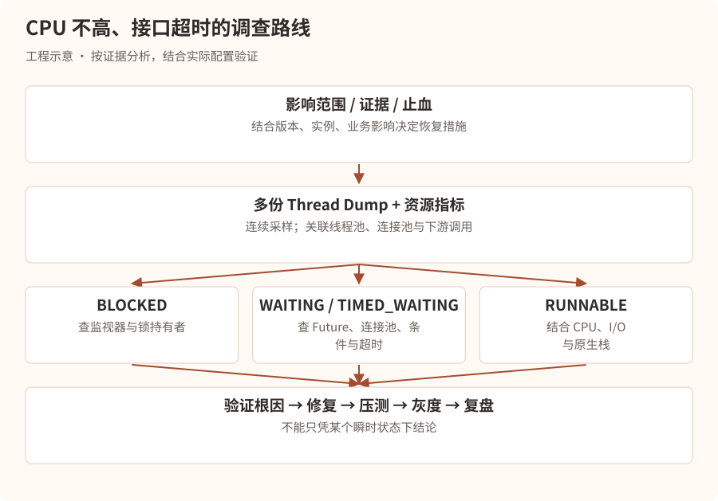

# 被困住的线程——CPU 只有 15%，为什么所有接口都超时了？

## 第一幕：一场没有任何征兆的瘫痪

上午 10:07。

星海科技总部，研发中心。

林川正坐在工位上修改昨天的 RAG 文档解析服务。

突然，企业微信群响起了密集的告警。

### 事故快照 · 虚构场景

| 项目 | 观测值 |
| --- | --- |
| 等级与时间 | P1 · 10:07:23 |
| 服务 | benefit-service-prod |
| CPU / JVM 堆 | 15% / 42% |
| P99 延迟 | 30s+ |
| Tomcat 忙碌线程 | 200/200 |
| 影响 | 大量 HTTP 504，领券失败 |

林川愣住了。

“CPU 才 15%，内存也正常，为什么服务器会崩？”

他第一时间查看 MySQL 监控。

连接数正常。

慢查询数量没有明显增加。

Redis 延迟正常。

RabbitMQ 消息积压也没有明显变化。

“难道是 Nginx 出问题了？”

他打开网关日志。

```
10:07:24 GET /api/coupon/receive 504 30.001s
10:07:25 GET /api/coupon/list    504 30.002s
10:07:26 GET /api/user/profile   504 30.001s
```

几乎所有接口都在超时。

此时，技术负责人陈默走了过来。

“查到什么了？”

“CPU 正常，内存正常，数据库正常，但所有请求都在超时。”

“那你有没有想过，CPU 低本身就是一条重要线索？”

林川抬起头。

“什么意思？”

陈默拉开椅子。

“如果线程一直在执行计算，CPU 可能很高。”

“但如果线程都在等待呢？”

“等待数据库？等待网络？”

“还有呢？”

“等待锁？”

陈默点点头。

“今天，我们要调查的不是一台忙碌的服务器。”

“而是一台所有工人都在上班，却没有一个人能够干活的服务器。”

## 第二幕：Tomcat 王国——200 个工人全部消失了

陈默在白板上画了一座餐厅。

“林川，你知道 Tomcat 的工作线程是什么吗？”

“就是处理 HTTP 请求的线程。”

“那我们用餐厅来理解。”

“假设 Tomcat 是一家餐厅，有 200 名服务员。”

“每当用户发送 HTTP 请求，就相当于有一名顾客进入餐厅。”

“服务员负责接待顾客、处理订单，最后返回结果。”

林川点点头。

“所以，一个请求通常会占用一个工作线程？”

“在传统 Spring MVC 同步请求处理模型中，通常如此。异步 Servlet、WebFlux 等模型的线程使用方式不同。”

陈默继续画图。



“现在假设 200 名服务员全部在等一把钥匙。”

“即使餐厅还有大量食材和厨房设备，也没有人能继续服务顾客。”

林川突然明白了。

“所以 CPU 低，并不代表服务有空闲处理能力。”

“对。”

“CPU 衡量的是计算资源使用情况，不是线程是否能够完成业务。”

“线程可能因为锁、数据库连接、网络 I/O、Future 结果等原因长时间等待。”

### 一个重要区别：忙碌线程不等于 RUNNABLE 线程

陈默补充：

“Tomcat 的 busy threads 指标通常反映工作线程正在承担请求处理任务。”

“但这些线程在 JVM 中可能处于 `RUNNABLE`、`BLOCKED`、`WAITING` 或 `TIMED_WAITING` 状态。”

“因此，看到 Tomcat 忙碌线程达到上限，下一步应该查看线程栈，而不是直接增加 `maxThreads`。”

林川问：

“为什么不能直接加到 500？”

“如果 200 个线程都被同一把锁阻塞，增加到 500，只是让更多线程一起等待。”

“而且线程越多，可能带来更多内存开销、上下文切换和下游资源压力。”

## 第三幕：Thread Dump——给 200 个线程拍一张合影

“那我们怎么知道线程在等待什么？”

林川问。

陈默打开终端。

“先找到 Java 进程。”

```
jps -l
```

输出：

```
18432 com.xinghai.BenefitApplication
```

“然后抓取线程快照。”

```
jcmd 18432 Thread.print -l > /tmp/thread-1.txt
```

陈默又连续抓取了两次。

“为什么要多次采样？”

“因为单次线程快照只能反映一个瞬间。如果连续多次看到相同线程等待相同资源，就能获得更强的证据。”

他打开文件。

```
"http-nio-8080-exec-17"
   java.lang.Thread.State: BLOCKED
    at com.xinghai.coupon.CouponService.receive(CouponService.java:48)
    - waiting to lock <0x000000071a2b3c40>
```

林川问：

“`BLOCKED` 是什么意思？”

“在 Java 的线程状态中，`BLOCKED` 通常表示线程正在等待进入一个 `synchronized` 监视器，或者等待重新获取该监视器。”

“那 `waiting to lock` 后面是什么？”

“是它正在等待的对象监视器标识。”

林川继续往下看。

```
"http-nio-8080-exec-18"
   java.lang.Thread.State: BLOCKED
    at com.xinghai.coupon.CouponService.receive(CouponService.java:48)
    - waiting to lock <0x000000071a2b3c40>
```

再往下：

```
"http-nio-8080-exec-19"
   java.lang.Thread.State: BLOCKED
    at com.xinghai.coupon.CouponService.receive(CouponService.java:48)
    - waiting to lock <0x000000071a2b3c40>
```

十个。

五十个。

一百个。

大量线程都在等待同一个监视器。

林川猛地站起来。

“找到了！所有线程都在争同一把锁！”

陈默却没有急着下结论。

“我们已经找到了大量等待者。”

“现在还有一个更重要的问题。”

“什么？”

“谁拿着这把锁？它为什么迟迟不释放？”

## 第四幕：锁的主人

林川搜索监视器标识。

```
grep -n -B 15 -A 25 '0x000000071a2b3c40' \
  /tmp/thread-1.txt
```

终于，他找到了持锁线程。

```
"http-nio-8080-exec-7"
   java.lang.Thread.State: TIMED_WAITING
    at jdk.internal.misc.Unsafe.park(Native Method)
    at java.util.concurrent.locks.LockSupport.parkNanos(...)
    at java.util.concurrent.CompletableFuture.get(...)
    at com.xinghai.rule.RemoteRuleClient.query(...)
    at com.xinghai.coupon.CouponService.receive(...)

    - locked <0x000000071a2b3c40>
```

林川看着这段栈，陷入沉思。

“等等。”

“这个线程不是 `BLOCKED`，而是 `TIMED_WAITING`。”

“它不是已经不运行了吗？”

陈默摇头。

“线程进入等待状态，不代表它自动释放已经持有的 synchronized 锁。”

“你看，线程栈里还有一行。”

```
- locked <0x000000071a2b3c40>
```

“说明它仍然持有这把监视器。”

林川突然意识到问题。

“也就是说，一个线程拿着锁去等待远程服务，其他所有线程都进不来？”

“没错。”

“这就是整个事故的核心。”

### 事故现场的线程关系



陈默解释：

“一个线程正在等待远程 I/O。”

“其他线程正在等待这个线程释放锁。”

“所以 CPU 不高，因为大量线程没有执行计算。”

“但 Tomcat 的工作线程全部被占用了，服务吞吐量迅速下降。”

“如果其他接口也依赖同一个 Tomcat 工作线程池，那么即使它们完全不使用这把锁，也可能因为拿不到工作线程而超时。”

林川点点头。

“原来一次局部锁竞争，竟然能导致整个服务不可用。”

## 第五幕：罪魁祸首——一个 synchronized 关键字

两人打开代码仓库。

```
@Service
public class CouponService {

    private final RemoteRuleClient ruleClient;

    public CouponService(RemoteRuleClient ruleClient) {
        this.ruleClient = ruleClient;
    }

    public synchronized CouponResult receive(Long userId) {
        // 查询远程规则服务
        Rule rule = ruleClient.query(userId);

        // 校验资格
        checkRule(rule);

        // 扣减库存
        deductStock(userId);

        return CouponResult.success();
    }
}
```

林川看了几秒。

“这个方法为什么加了 `synchronized`？”

陈默打开 Git 历史。

提交说明写着：

> 修复高并发情况下优惠券重复领取问题。

林川恍然大悟。

“原来开发人员担心并发安全，就给整个方法加锁。”

“是的。但这带来了三个严重问题。”

### 问题一：锁的粒度太大

陈默说道：

“假设整个方法需要 500ms，其中真正需要互斥的操作只有 5ms。”

“如果给整个方法加锁，所有请求都必须串行执行这 500ms。”

“理论上，单实例这段串行路径的吞吐量上限大约是：”

**QPS ≈ 1 ÷ 0.5 = 2**

“也就是每秒只能完成大约两个请求。”

“但如果能够安全地把临界区缩小到 5ms，单从这段串行临界区的理论上限看：”

**QPS ≈ 1 ÷ 0.005 = 200**

“当然，真实吞吐量还会受到 CPU、数据库、网络和其他共享资源限制。”

“但这说明锁的持有时间有多么重要。”

### 问题二：锁里面存在远程调用

陈默指着：

```
Rule rule = ruleClient.query(userId);
```

“这段调用的耗时由谁决定？”

“远程规则服务。”

“如果它平时只需要 30ms，但今天突然变成 10 秒呢？”

“那么当前线程可能持锁等待 10 秒。”

“如果远程客户端没有合理的超时设置，等待甚至可能更长。”

陈默补充：

“即使设置了超时，也要考虑连接超时、读取超时、请求总超时和重试策略之间的关系。不能只配置一个数字，就以为整个调用一定能在这个时间内结束。”

### 问题三：synchronized 只能保护当前 JVM 内的监视器

林川突然想到：

“可是我们线上部署了三个 Spring Boot 实例。”

“对。”

“每个实例都有自己的 CouponService Bean，也有自己的对象锁。”

“那么三个实例之间的锁根本不互通？”

“正确。”

“所以，这个 synchronized 不仅导致了严重性能问题，甚至不能完整解决分布式环境下的重复领取问题。”

陈默在白板上写下：

**JVM 内互斥 ≠ 分布式业务唯一性**

“这就是很多初级工程师容易犯的错误。”

“把线程安全、业务幂等、数据库一致性和分布式协调当成同一件事。”

## 第六幕：真正的解决方案

林川立即说道：

“那我们把 synchronized 删除不就行了？”

陈默表情严肃起来。

“你确定？”

“……”

“如果删除之后，两个并发请求同时领取同一张优惠券，怎么办？”

林川沉默。

“所以线上修复不能只考虑性能，还要保证业务正确性。”

“这次我们需要重新设计并发控制。”

### 方案一：把远程调用移出锁

陈默先给出了一个最小改动的思路。

```
public CouponResult receive(Long userId) {
    // 不持锁执行远程调用
    Rule rule = ruleClient.query(userId);

    synchronized (this) {
        checkRule(rule);
        deductStock(userId);
        return CouponResult.success();
    }
}
```

“这样能缩短锁的持有时间，但仍然存在两个问题。”

“第一，所有用户依旧争抢同一把锁。”

“第二，这把锁仍然只能保护当前实例。”

“而且如果锁内执行数据库或 Redis 远程操作，依然可能出现长时间持锁。”

林川问：

“那真正的生产方案呢？”

“根据业务不变量设计原子操作和持久化约束。”

### 方案二：Redis Lua + MySQL 唯一索引 + 异步履约

陈默重新画出权益发放链路。



“Redis Lua 可以保证脚本中的操作在单个 Redis 执行上下文中原子执行，避免多个请求交错修改同一份库存和领取标记。”

“但 Redis 原子性不等于 Redis、RabbitMQ 和 MySQL 三者之间存在一个原子事务。”

> **工程补充**：Transactional Outbox 的前提是业务状态与待发送事件写入同一个数据库本地事务。Redis Lua 预扣与 MySQL Outbox 之间仍有失败窗口，需要可恢复的预占记录、幂等事件标识、超时释放和对账；不能只加一个 Outbox 表就宣称跨系统原子。Redis Cluster 中脚本访问的键还应满足同槽约束。

林川点点头。

“所以还需要消息可靠投递、消费幂等、失败补偿，以及最终状态对账。”

“没错。”

“对于用户重复领取，MySQL 可以设置类似 `(activity_id, user_id)` 的唯一约束，前提是业务规则确实规定每人每活动只能领取一次。”

“而对于跨服务履约，需要根据业务决定何时返回领取成功、如何处理库存预占超时、如何补偿失败任务。”

林川总结：

“原来正确解决并发问题，不是给所有代码套一把锁，而是识别真正需要保证的业务不变量，再选择合适的原子操作和一致性机制。”

“正是如此。”

## 第七幕：四种线程状态，四种完全不同的故障

事故恢复后，陈默没有让林川离开。

“你今天只遇到了 `BLOCKED`。”

“但生产环境还有其他线程状态，排查方式不同。”

他打开 Java 的 `Thread.State` 枚举。

### 1. RUNNABLE：正在运行，或者准备运行

“如果一个线程处于 `RUNNABLE`，意味着它在 JVM 线程状态模型中处于可执行状态。”

“但要注意，在 HotSpot/Linux 上，某些执行原生 I/O 的线程也可能显示为 RUNNABLE。”

“因此不能直接认为 RUNNABLE 就一定在消耗 CPU。”

典型问题：

- 死循环。
- 大量 JSON 序列化。
- 高复杂度算法。
- 部分网络 I/O 或原生调用。

排查时结合：

```
top -H -p <PID>
```

以及线程栈、CPU Profiling。

### 2. BLOCKED：等待进入 synchronized

典型线程栈：

```
java.lang.Thread.State: BLOCKED
- waiting to lock <0x12345678>
```

“这种情况，优先寻找锁的持有者。”

“如果大量线程都在等待同一个监视器，说明可能存在严重的锁竞争。”

### 3. WAITING：无限期等待某个条件

例如：

```
future.get();
```

当结果尚未完成且没有设置超时，线程可能一直等待。

但陈默提醒：

“`WAITING` 不一定是异常。”

“线程池中的空闲工作线程可能正常地等待任务。”

“所以不能简单统计 WAITING 数量，就认定系统故障。”

### 4. TIMED_WAITING：有限时间等待

例如：

```
Thread.sleep(1000);
```

或者：

```
future.get(3, TimeUnit.SECONDS);
```

“它意味着线程进入了带时间限制的等待状态，但不代表业务一定会在预期时间完成。”

“例如多次重试、嵌套调用和多个超时叠加，仍可能让整体请求耗时很长。”

### Java 线程状态速查

| 状态            | 典型场景                | 排查重点        |
| ------------- | ------------------- | ----------- |
| NEW           | 线程尚未启动              | 通常不是线上阻塞根因  |
| RUNNABLE      | 计算、可运行、部分原生 I/O     | CPU、调用栈     |
| BLOCKED       | 等待 synchronized 监视器 | 锁持有者、临界区    |
| WAITING       | 无超时等待结果或条件          | 等待对象、唤醒条件   |
| TIMED_WAITING | sleep、带超时等待         | 超时设置、重试     |
| TERMINATED    | 线程执行结束              | 线程异常退出或正常结束 |

## 第八幕：另一场灾难——数据库连接池耗尽

下午 2:30。

陈默突然给林川发来一份新的事故日志。

“这是另一个服务的 Thread Dump。”

```
"http-nio-8080-exec-31"
   java.lang.Thread.State: TIMED_WAITING
    at jdk.internal.misc.Unsafe.park(...)
    at java.util.concurrent.locks.LockSupport.parkNanos(...)
    at com.zaxxer.hikari.pool.HikariPool.getConnection(...)
```

林川看完说道：

“线程在等待数据库连接。”

“对。”

“假设 HikariCP 最大连接池只有 20 个连接，但有 200 个 Tomcat 请求线程。”

“当 20 个连接全部被占用，后续请求会怎样？”

“等待空闲连接。”

“如果连接长时间不归还呢？”

“等待线程不断积累，最终可能耗尽 Tomcat 工作线程。”

陈默问：

“那你第一反应是不是把连接池从 20 改成 200？”

林川笑了。

“不能直接改。”

“为什么？”

“因为连接池耗尽可能是 SQL 太慢、事务持有连接过久、连接泄漏，或者数据库本身处理能力不足。”

“增加连接数可能把压力直接转移到 MySQL。”

“很好。”

### 数据库连接池耗尽的典型链路

慢 SQL / 长事务 / 连接未归还

数据库连接长期被占用

HikariCP 无空闲连接

Tomcat 工作线程等待连接

接口超时，服务吞吐量下降

“这就是为什么 CPU 很低，服务却可能完全不可用。”

“因为系统的瓶颈不一定是 CPU。”

“可能是任何一个容量有限的共享资源。”

## 第九幕：线程池饥饿——工人等待自己完成任务

陈默又拿出一段代码。

```
ExecutorService pool =
    Executors.newFixedThreadPool(1);

Future<String> outer = pool.submit(() -> {
    Future<String> inner = pool.submit(() -> {
        return "done";
    });

    return inner.get();
});

System.out.println(outer.get());
```

“林川，这段代码会发生什么？”

林川思考了几秒。

“线程池只有一个线程。”

“外层任务占用了唯一的工作线程。”

“然后外层任务又往同一个线程池提交内部任务。”

“接着调用 `inner.get()` 等待内部任务完成。”

“但内部任务需要工作线程才能执行，而唯一的线程正被外层任务占着。”

他猛地抬头。

“所以内部任务永远无法执行！”

“对。”

“这叫线程池饥饿死锁的一种典型形式。”

### 死锁并不一定发生在 synchronized 上

陈默解释：

“很多人一提到死锁，就只想到两个线程互相持有两把锁。”

“但线程池、Future、信号量和其他有限资源，也可能形成循环等待。”

“在这段代码中，外层任务等待内层任务完成，而内层任务等待工作线程空闲。”

“双方形成无法自行解除的等待关系。”



林川问：

“那应该怎么解决？”

陈默回答：

“优先避免在同一个容量有限的线程池中，提交子任务后又同步等待子任务。”

“可以重新组织任务依赖关系、使用合适的异步组合方式，或者在确有必要时隔离不同任务类型的执行资源。”

“但单纯增大线程池容量，仍可能只是暂时缓解。”

## 第十幕：真正的死锁——两把锁与两个囚徒

陈默决定再加一道题。

“假设两个线程分别持有两把锁。”

“线程 A 持有 Lock1，等待 Lock2。”

“线程 B 持有 Lock2，等待 Lock1。”

“会发生什么？”

“死锁。”

“写出来。”

林川打开 IDE。

```
public class DeadlockDemo {

    private static final Object LOCK1 = new Object();
    private static final Object LOCK2 = new Object();

    public static void main(String[] args) {

        Thread t1 = new Thread(() -> {
            synchronized (LOCK1) {
                synchronized (LOCK2) {
                    System.out.println("T1 finished");
                }
            }
        });

        Thread t2 = new Thread(() -> {
            synchronized (LOCK2) {
                synchronized (LOCK1) {
                    System.out.println("T2 finished");
                }
            }
        });

        t1.start();
        t2.start();
    }
}
```

陈默说道：

“注意，这段代码存在死锁风险，但不保证每次运行都发生死锁，因为线程调度顺序不同。”

“现在你告诉我，死锁的四个必要条件是什么？”

林川回答：

1. 互斥条件：资源同一时刻只能被一个线程占有。
2. 请求并保持条件：线程持有资源的同时继续等待其他资源。
3. 不可剥夺条件：已获得的资源不能被其他线程强制夺走。
4. 循环等待条件：多个线程之间形成循环等待链。

“正确。”

“那如何解决？”

“最常见的方式之一是统一加锁顺序，破坏循环等待条件。”

例如所有线程都按：

```
synchronized (LOCK1) {
    synchronized (LOCK2) {
        // business logic
    }
}
```

“此外，对于 `ReentrantLock`，可以在适当场景下使用 `tryLock` 和超时机制，避免无限期等待。”

“但必须注意获取失败后的释放、重试、回滚和业务一致性处理。”

### 生产环境怎么发现死锁？

```
jcmd <PID> Thread.print -l
```

HotSpot 在支持的场景下，可以检测并报告 Java 监视器或部分显式锁相关的死锁。

但陈默提醒：

“并不是所有逻辑上的死锁都能被 JVM 自动识别。”

“例如刚才的线程池饥饿问题，可能没有传统的锁循环关系。”

“所以依然需要根据任务依赖、线程状态和资源使用情况进行分析。”

## 第十一幕：真正的生产排查流程

下午 5:10。

林川把今天的事故整理成了一套方法。

陈默看完后，只改了一个地方。

“你写的是先抓线程栈，再止血。”

“但如果业务已经大面积不可用，你应该先判断是否需要立即止血。”

“排查和止血可以并行，但不能为了研究问题而无限拖延恢复业务。”

### CPU 低、接口超时的排查路线



陈默补充：

“还要同时看几个关键指标。”

| 指标                          | 主要用途        |
| --------------------------- | ----------- |
| Tomcat busy threads         | 判断工作线程是否被占满 |
| Tomcat current threads      | 判断线程池当前规模   |
| HikariCP active connections | 判断数据库连接占用   |
| HikariCP pending threads    | 判断是否有线程等待连接 |
| 线程状态分布                      | 判断是否存在集中等待  |
| 接口 P95/P99                  | 判断尾延迟是否恶化   |
| 下游调用耗时                      | 定位远程依赖      |
| 线程池队列长度                     | 判断任务是否积压    |

“另外，所有线程池和连接池的指标，都应该结合业务吞吐量、错误率和时间趋势分析，不能只凭某一个瞬时数字下结论。”

## 第十二幕：面试官的拷问

第二天上午。

陈默坐在会议室里，打开录音笔。

“现在假设你在面试一家大型互联网公司的 Java 后端岗位。”

“我问你一个场景题。”

面试官：线上接口突然大量超时，但 CPU 和内存都正常，你会怎么排查？

林川思考了几秒，开始回答。

“首先，我会确认故障范围，包括是否所有接口都超时、是否只有部分实例异常，以及最近是否存在发布或流量变化。”

“如果业务影响严重，我会优先评估回滚、切流、限流或降级，同时尽可能保留现场信息。”

“然后我会查看 Tomcat 工作线程数、线程池队列、数据库连接池和下游调用耗时，判断是否存在资源耗尽。”

“如果 Tomcat 工作线程接近上限，我会通过 `jcmd Thread.print` 获取多份线程栈，观察线程主要处于什么状态。”

“如果大量线程处于 `BLOCKED`，我会寻找共同等待的锁及其持有者，检查是否存在锁粒度过大、锁内远程调用或死锁。”

“如果大量线程等待数据库连接，我会检查 HikariCP 的 active、idle、pending 指标，并结合 MySQL 慢 SQL、长事务和连接泄漏情况定位问题。”

“如果线程在等待 Future 或远程服务，我会检查任务依赖、超时配置、重试策略和下游服务状态，判断是否存在同步等待、线程池饥饿或下游阻塞。”

“最后根据根因优化锁粒度、隔离线程池、修复连接泄漏、调整超时或重构业务流程，再通过压测和灰度验证。”

陈默问：

“为什么不直接增加 Tomcat 的 maxThreads？”

林川回答：

“因为如果瓶颈是锁竞争、数据库连接池或下游服务，增加 Tomcat 线程数不能提高瓶颈资源的处理能力，反而可能增加等待线程、内存占用和下游压力。”

陈默继续追问：

“那为什么 CPU 只有 15%，系统却完全不可用？”

林川回答：

“因为 CPU 使用率只反映计算资源消耗。大量线程可能因为锁、I/O、连接池或任务依赖而阻塞，虽然不消耗多少 CPU，但仍然占用有限的请求处理资源，最终导致新请求无法及时处理。”

陈默合上录音笔。

“这次你真正理解了线程池和锁，而不是只会背 `synchronized` 和 `ReentrantLock` 的区别。”

## 本章技术总结

CPU 低不代表系统健康。 阻塞、等待和有限资源耗尽都可能导致服务不可用。

Tomcat 工作线程被占满，不等于 CPU 被打满。 工作线程可能正在等待锁、连接或下游响应。

锁的持有者比等待者更重要。 排查大量 BLOCKED 线程时，要找到谁持锁以及为什么不释放。

不要在大范围锁中执行慢 I/O。 远程调用、数据库操作和长时间等待可能显著放大锁竞争。

线程池、数据库连接池和锁都是有限资源。 扩大其中一个池，不代表整体吞吐量一定提高。

## 下一章预告

## 第四章：《数据库的死亡倒计时——一条 SQL 拖垮整个系统》

上午 11:20，营销系统的订单查询接口突然从 30ms 飙升到 18 秒。

MySQL CPU 达到 95%，数据库连接池逐渐耗尽，所有依赖数据库的接口开始超时。

但开发人员坚称：“这条 SQL 已经加索引了，不可能慢！”

林川随后发现，真正的问题竟然隐藏在一个看似普通的 `ORDER BY` 和 `LIMIT 1000000, 20` 中。

下一章将围绕一次完整的 MySQL 生产事故，深入讲解 慢 SQL 定位、EXPLAIN、EXPLAIN ANALYZE、索引失效、回表、覆盖索引、深分页、排序、临时表、连接池耗尽，以及 SQL 优化为什么必须结合真实数据分布和执行计划。
