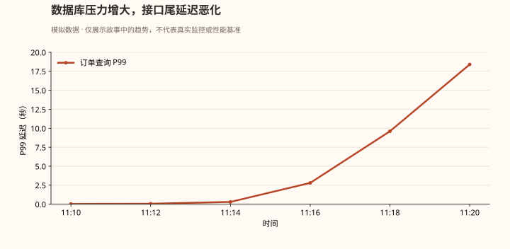
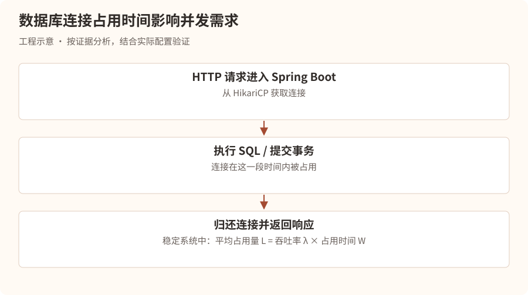
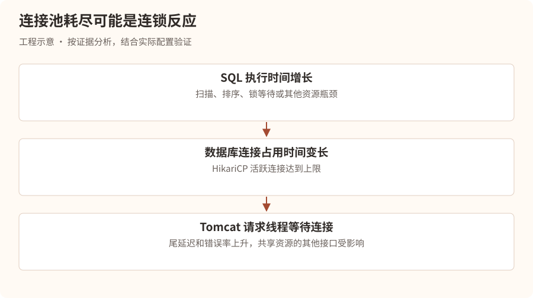
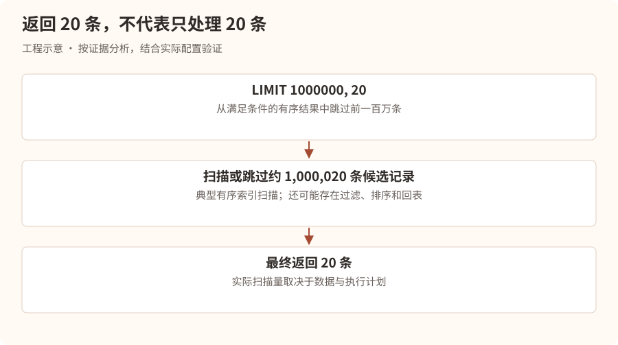
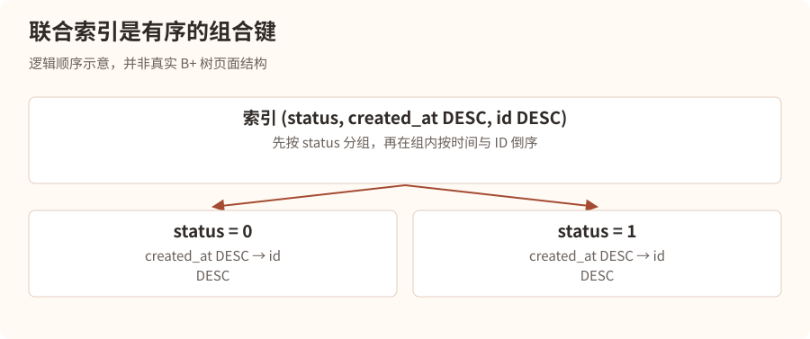
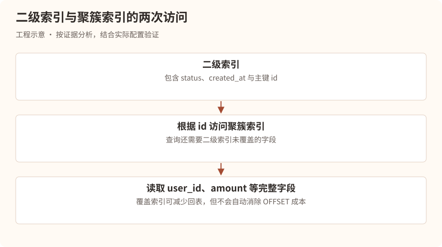
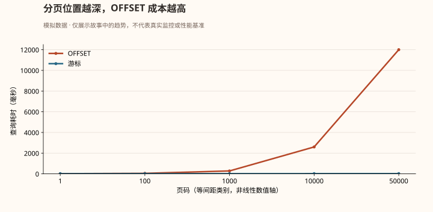
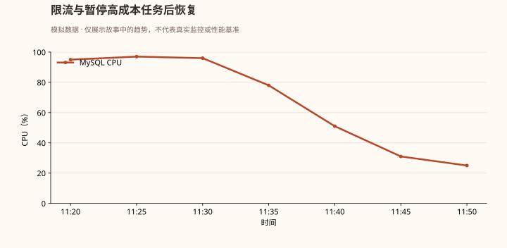

# 数据库的死亡倒计时——一条 SQL 如何拖垮整个系统

## 第一幕：上午十一点，数据库开始窒息

上午 11:20。

星海科技，研发中心。

林川刚刚解决了上一场线程池阻塞事故。

他以为自己已经掌握了线上故障排查的基本方法。

直到一条来自 MySQL 的告警出现在屏幕上。

### 事故快照 · 虚构场景

| 项目 | 观测值 |
| --- | --- |
| 等级与时间 | P1 · 11:20:36 |
| 实例 | mysql-order-primary |
| MySQL CPU | 95% |
| 接口 P99 延迟 | 18.4s |
| HikariCP 活跃连接 | 50/50 |
| 接口错误率 | 32.7% |
| 影响 | 订单列表超时，部分支付查询受影响 |

“又出事了？”

林川打开 Grafana。

过去十分钟，订单查询接口的响应时间从几十毫秒一路上涨。



他立即查看应用日志。

```
SQLTransientConnectionException:
HikariPool-1 - Connection is not available,
request timed out after 30000ms.
```

“数据库连接池耗尽？”

林川想起了上一章。

“是不是连接泄漏？”

这时，技术负责人陈默走进办公室。

“先别下结论。”

“连接池耗尽只是现象。连接可能没有泄漏，而是被长时间运行的 SQL 占用了。”

“那该怎么判断？”

陈默打开数据库监控。

“今天我们要调查的是一条 SQL。”

“它没有死循环，没有语法错误，甚至使用了索引。”

“但它几乎拖垮了整个数据库。”

## 第二幕：第一条线索——连接池为什么耗尽？

陈默没有立即查看 SQL。

他先问了一个问题。

“假设你的 HikariCP 最大连接数是 50，为什么会被占满？”

林川回答：

“可能是并发请求太多，也可能是 SQL 执行太慢、事务太长，或者连接没有归还。”

“很好。”

“那我们先理解连接池为什么会被慢 SQL 拖垮。”

### 一条请求的生命

正常情况下：



陈默在白板上写下一条公式：

**L = λ × W**

“这是 Little 定律。”

“在稳定系统中，平均在系统内的请求数量，等于吞吐率乘以平均停留时间。”

“假设每秒有 100 个需要数据库连接的请求，每个请求平均占用连接 20ms。”

**100 × 0.02 = 2**

“平均大约需要两个被占用的连接。”

“但是，如果 SQL 从 20ms 变成 2 秒呢？”

**100 × 2 = 200**

林川一惊。

“平均需要 200 个连接才能维持同样的吞吐！”

“对。但你的连接池只有 50 个。”

“于是请求开始等待连接，排队越来越严重。”

“注意，这里的 200 是假设系统仍能稳定维持原有吞吐时的平均并发占用需求，并不是说连接池真的能提供 200 个连接。实际上，系统会受到容量限制，吞吐下降并出现排队和超时。”

### 为什么慢 SQL 会引起连锁故障？



“所以，”陈默说道，“线上排查最重要的是区分根因与连锁反应。”

“数据库连接池耗尽，可能只是慢 SQL 的下游症状。”

## 第三幕：寻找凶手——究竟是哪条 SQL？

林川打开 MySQL 终端。

“我先执行 `SHOW PROCESSLIST`。”

```
SHOW FULL PROCESSLIST;
```

屏幕上出现大量类似记录：

```
Id     Time   State          Info
-----------------------------------------------
421    12     Sending data   SELECT ... FROM orders
427    15     Sending data   SELECT ... FROM orders
435    17     Sending data   SELECT ... FROM orders
```

“都是订单查询！”

陈默说道：

“`SHOW FULL PROCESSLIST` 可以帮助我们查看当前连接及正在执行的语句。”

“不过，`Sending data` 这样的状态名不能直接理解为正在向客户端传输数据。它也可能涵盖读取、处理和返回查询结果的过程。”

“我们需要进一步确认哪类 SQL 消耗了最多资源。”

### 第一件武器：慢查询日志

```
SHOW VARIABLES LIKE 'slow_query_log';
SHOW VARIABLES LIKE 'long_query_time';
```

陈默解释：

“慢查询日志可以记录执行时间超过阈值的语句。”

“但线上修改日志配置需要考虑日志量、I/O 和管理规范，不能随意在高负载数据库上开启大量详细日志。”

林川查看已有的慢查询日志。

```
Query_time: 18.241
Rows_examined: 1000020
Rows_sent: 20
```

下面是一条 SQL：

```
SELECT
    id,
    user_id,
    amount,
    status,
    created_at
FROM orders
WHERE status = 1
ORDER BY created_at DESC
LIMIT 1000000, 20;
```

林川皱起眉头。

“这条 SQL 看起来很普通。”

“而且 `status` 和 `created_at` 都有索引。”

陈默问：

“你觉得数据库为了返回 20 条记录，需要处理多少条？”

“20 条？”

“你再看看 `LIMIT`。”

林川看了一眼。

```
LIMIT 1000000, 20
```

他突然意识到问题。

“要跳过前面一百万条！”

陈默点点头。

“这就是今天的第一个凶手。”

## 第四幕：深分页——为了寻找二十个人，翻过一百万份档案

陈默在白板上画了一座巨大的档案馆。

“假设数据库是一座档案馆。”

“你想找最新的 20 份订单。”

“如果直接取第一页，管理员只需要找到最前面的 20 份。”

“但如果你说，先跳过一百万份，再给我后面的 20 份呢？”

林川回答：

“那管理员就得先走过前面一百万份。”

“对。”

“即使这些档案已经按照时间排序，也不代表数据库可以直接跳到第 1000001 条。”

### LIMIT 的真正含义

```
LIMIT 1000000, 20;
```

相当于：

```
LIMIT 20 OFFSET 1000000;
```

在典型的有序索引扫描执行计划中，MySQL 需要扫描或跳过大量符合条件的索引记录，才能返回最后 20 条。

如果还涉及回表、排序、过滤等操作，成本可能进一步增加。



林川问：

“可是我们给 `created_at` 建了索引，为什么还是慢？”

陈默回答：

“因为索引解决的是查找和有序访问的问题。”

“它不能自动消除深分页需要跳过大量记录的成本。”

“使用了索引，不等于 SQL 一定高效。”

## 第五幕：EXPLAIN——审问 MySQL 优化器

“那我们怎么知道 MySQL 到底执行了什么？”

林川问。

陈默打开终端。

“用 `EXPLAIN`。”

```
EXPLAIN
SELECT
    id, user_id, amount, status, created_at
FROM orders
WHERE status = 1
ORDER BY created_at DESC
LIMIT 1000000, 20;
```

假设查询计划如下：

| type  | key            | rows    | Extra       |
| ----- | -------------- | ------- | ----------- |
| index | idx_created_at | 2500000 | Using where |

林川问：

“`type=index` 不是说明走索引了吗？”

“是使用了索引扫描访问方式，但并不代表只读取了少量数据。”

“`index` 往往意味着扫描索引中的一段甚至大量条目。”

“和 `const`、`ref`、`range` 等访问方式相比，不能单凭名称判断实际性能，仍然要结合扫描量和执行时间。”

### EXPLAIN 中最值得关注的字段

| 字段            | 主要含义             |
| ------------- | ---------------- |
| type          | 表访问方式            |
| possible_keys | 优化器认为可能使用的索引     |
| key           | 实际选择的索引          |
| rows          | 估计需要检查的行数        |
| filtered      | 估计过滤后保留的比例       |
| Extra         | 排序、覆盖索引、临时表等额外信息 |

陈默继续说道：

“尤其注意，`rows` 通常是优化器估算值，不是实际扫描行数。”

“如果要看实际执行情况呢？”

林川回答：

“`EXPLAIN ANALYZE`？”

“对。MySQL 8.0.18 及之后的版本支持它。”

```
EXPLAIN ANALYZE
SELECT ...
```

“它会真正执行语句，并给出执行计划中各节点的实际耗时和行数信息。”

“所以线上使用时必须谨慎，尤其不能在事故高峰期随意执行可能产生巨大开销的查询。”

### EXPLAIN 与 EXPLAIN ANALYZE 的区别

EXPLAIN

主要展示优化器选择的执行计划和估算成本，通常不实际执行目标 SELECT。

EXPLAIN ANALYZE

实际执行语句并收集运行时统计，可以对比估算行数和实际行数，发现优化器估计偏差。

“林川，记住。”

“优化 SQL，不是看有没有索引。”

“而是看 MySQL 实际如何访问数据、处理多少行、执行多少次操作，以及耗费多少时间。”

## 第六幕：第二个凶手——索引明明存在，为什么还要排序？

林川继续检查订单表结构。

```
CREATE TABLE orders (
    id BIGINT PRIMARY KEY,
    user_id BIGINT NOT NULL,
    amount DECIMAL(10,2) NOT NULL,
    status TINYINT NOT NULL,
    created_at DATETIME NOT NULL,

    KEY idx_status (status),
    KEY idx_created_at (created_at)
);
```

“我们已经有 `status` 和 `created_at` 两个索引。”

“那为什么还会慢？”

陈默反问：

“你的 SQL 需要做哪两件事？”

“先过滤 `status = 1`，然后按照 `created_at DESC` 排序。”

“那两个独立索引就一定能同时高效完成过滤和排序吗？”

“不一定。”

“对。”

“如果 MySQL 使用 `idx_status` 找到所有状态为 1 的订单，它可能还需要对结果进行排序。”

“如果使用 `idx_created_at` 按时间顺序扫描，它可能需要逐条判断 `status` 是否等于 1。”

“优化器会根据统计信息和成本模型选择计划。”

### 联合索引登场

陈默写下：

```
CREATE INDEX idx_status_created_id
ON orders(status, created_at DESC, id DESC);
```

“对于下面的查询：”

```
SELECT id, user_id, amount, status, created_at
FROM orders
WHERE status = 1
ORDER BY created_at DESC, id DESC
LIMIT 20;
```

“这个联合索引通常更有利于按照 `status` 定位，再按照 `created_at` 和 `id` 的顺序读取数据。”

“因为 `status` 是等值条件，后续索引列的顺序可以用于满足排序要求。”

林川问：

“为什么还要加 `id`？”

“因为 `created_at` 可能重复。”

“如果只按时间排序，多个订单的时间相同，分页边界可能不稳定。”

“加上唯一的 `id`，就能形成确定性的排序顺序。”

> **工程补充**：确定性排序不等于多次翻页共享同一个数据快照。若翻页期间排序字段或筛选条件发生更新，仍可能漏读或重复；需要明确业务是否接受实时变化，或采用快照、版本边界等策略。

### 联合索引的排列方式为什么重要？

陈默画出一个 B+ 树索引的简化顺序。



“但要注意，”陈默补充，“联合索引不是越长越好。”

“它会增加存储空间和写入维护成本。”

“而且是否真正使用索引完成排序，还要看查询条件、排序方向、执行计划和 MySQL 版本。”

## 第七幕：回表——索引找到了地址，却还要跑一趟仓库

林川突然问：

“既然联合索引已经包含 `status`、`created_at` 和 `id`，为什么查询仍然可能很慢？”

陈默回答：

“因为你的 SELECT 还需要 `user_id` 和 `amount`。”

“而它们不在这个二级索引中。”

“这就涉及回表。”

### InnoDB 的两种索引

陈默解释：

“在 InnoDB 中，聚簇索引的叶子记录存储整行数据。”

“对于常见的以主键作为聚簇索引的表，二级索引的叶子记录包含索引列和用于定位聚簇记录的主键值。”

“因此，当查询需要的字段不在二级索引中时，MySQL 可能需要根据主键再次访问聚簇索引。”

这就是回表。



“如果深分页过程中，执行计划对大量候选行进行回表，成本可能很高。”

“那怎么优化？”

“其中一种方式是先在覆盖索引中完成分页，取得少量 ID，再根据这些 ID 获取完整数据。”

例如：

```
SELECT o.id, o.user_id, o.amount,
       o.status, o.created_at
FROM orders o
JOIN (
    SELECT id
    FROM orders
    WHERE status = 1
    ORDER BY created_at DESC, id DESC
    LIMIT 1000000, 20
) page ON o.id = page.id
ORDER BY o.created_at DESC, o.id DESC;
```

林川眼睛一亮。

“内层查询只使用索引列，减少大规模回表，外层只对 20 条记录获取完整字段。”

“对。”

“不过，这并没有消除跳过一百万条索引记录的成本。”

“所以它只是针对某些执行计划的优化，而不是深分页的根本解决方案。”

## 第八幕：真正的解决方案——游标分页

陈默关闭了旧 SQL。

“现在我们不再让数据库翻过一百万条记录。”

“我们换一种思路。”

“假设用户已经看到了第 100 页。”

“他想看下一页。”

“你真的需要告诉数据库，这是第 101 页吗？”

林川思考片刻。

“不一定。”

“如果知道上一页最后一条记录的时间和 ID，就可以直接从那里继续查询。”

“这就是 Keyset Pagination，也叫游标分页。”

### 传统 OFFSET 分页

```
SELECT id, user_id, amount, created_at
FROM orders
WHERE status = 1
ORDER BY created_at DESC, id DESC
LIMIT 1000000, 20;
```

需要跳过大量记录。

### 游标分页

假设上一页最后一条记录：

```
created_at = 2026-10-16 10:30:00
id         = 987654
```

下一页查询：

```
SELECT id, user_id, amount, created_at
FROM orders
WHERE status = 1
  AND (
      created_at < '2026-10-16 10:30:00'
      OR (
          created_at = '2026-10-16 10:30:00'
          AND id < 987654
      )
  )
ORDER BY created_at DESC, id DESC
LIMIT 20;
```

“这样数据库就可以利用索引，从游标附近继续读取后续记录。”

“而不必每次从头跳过一百万条。”

陈默补充：

“这里的游标不是数据库服务端 Cursor，而是由业务保存的分页位置。”

“另外，在支持行构造器比较的 MySQL 中，也可以写成类似 `(created_at, id) < (?, ?)` 的形式，但具体索引利用情况仍需要通过执行计划验证。”

### OFFSET 与游标分页对比



林川说道：

“所以游标分页的优势，是查询成本通常不会随着页码线性增加。”

“对，但有前提。”

“必须有合适的索引，游标字段需要形成稳定排序，而且查询条件要与索引匹配。”

“另外，游标分页不擅长直接跳转到任意页码。”

“如果业务必须支持跳转到第 50000 页，就需要考虑其他方案，比如限制最大翻页深度、搜索引擎、预计算、异步导出，或者重新设计产品交互。”

## 第九幕：索引失效的六种陷阱

事故已经找到主要原因。

但陈默并没有停止教学。

“林川，今天我们遇到的是深分页。”

“下次可能是索引失效。”

“你需要知道，哪些 SQL 写法会让索引难以发挥作用。”

他在白板上列出了六种典型情况。

### 陷阱一：对索引列进行函数运算

```
SELECT *
FROM orders
WHERE DATE(created_at) = '2026-10-16';
```

普通的 `created_at` 索引通常难以直接用于这种函数表达式的范围定位。

更推荐：

```
SELECT *
FROM orders
WHERE created_at >= '2026-10-16'
  AND created_at <  '2026-10-17';
```

“这样更容易使用索引范围扫描。”

“但如果有合适的函数索引或生成列索引，也可能有其他优化方案。”

### 陷阱二：LIKE 前置通配符

```
SELECT *
FROM users
WHERE name LIKE '%张三';
```

普通 B+ 树索引通常无法高效进行前缀定位。

但：

```
WHERE name LIKE '张三%';
```

通常更容易利用索引范围。

### 陷阱三：隐式类型转换

```
SELECT *
FROM users
WHERE phone = 13800138000;
```

假设 `phone` 是字符串类型。

“这种写法可能引发类型转换和不符合预期的索引利用。”

“但不能简单记成只要发生隐式转换就一定不走索引，具体还要看类型、转换方向和优化器。”

“最稳妥的做法是让参数类型与字段类型一致。”

### 陷阱四：联合索引不满足有效前缀条件

假设索引：

```
INDEX idx_abc(a, b, c)
```

查询：

```
WHERE b = 10 AND c = 20
```

“通常无法像 `a = ? AND b = ?` 那样充分利用索引的前导列。”

“不过 MySQL 某些版本和场景可能采用 Skip Scan 等优化，不能把最左前缀规则理解成绝对的‘完全不使用索引’。”

### 陷阱五：OR 条件

```
WHERE user_id = 100
   OR amount > 500;
```

“如果两个条件的索引选择性、数据分布和成本不合适，优化器可能选择全表扫描。”

“某些情况下也可能使用 Index Merge。”

“所以 `OR` 不等于必然索引失效。”

### 陷阱六：选择性太低

```
WHERE status = 1
```

“假设全表 95% 的订单都是状态 1。”

“即使 `status` 有索引，优化器也可能认为全表扫描更便宜。”

“因为通过二级索引找到大量记录，再进行回表，可能比直接扫描表还慢。”

林川总结：

“所以索引是否有效，最终还是要看数据分布和执行计划。”

“没错。”

“不要把 SQL 优化变成背诵‘索引失效口诀’。”

## 第十幕：生产环境真正的止血方案

上午 11:38。

故障仍在持续。

陈默问林川：

“现在已经知道是深分页造成的慢 SQL，你会怎么止血？”

林川回答：

“先把 SQL 改成游标分页，然后发布。”

“太慢了。”

“那怎么办？”

“线上事故首先要恢复服务。”

他们采取了以下措施：

1. 在 API Gateway 对订单深分页查询进行临时限流。
2. 对超过安全分页深度的请求返回明确错误，避免继续打满数据库。
3. 暂停触发超深分页的批量导出任务。
4. 对已经确认的高成本查询进行受控处理，避免随意终止正常事务。
5. 在数据库压力下降后，逐步恢复正常请求。

陈默提醒：

“限流阈值必须结合实际容量和业务优先级确定。”

“对于已执行中的 SQL，必要时可以考虑 `KILL QUERY`，但要先确认目标会话和语句，避免误伤关键业务。”

“而且杀掉查询不代表根因解决，客户端如果立即重试，还可能重新制造压力。”

### 故障恢复曲线



“数据库恢复了。”

林川松了一口气。

陈默却说道：

“接下来才是修复。”

“我们需要修改分页接口、补充联合索引、验证执行计划、进行压测，并通过灰度发布观察实际效果。”

“另外，还要检查是不是存在其他接口共享同一个连接池、同一个数据库实例，导致故障扩散。”

## 第十一幕：慢 SQL 排查的完整作战手册

陈默要求林川整理一套可以直接用于生产排查的流程。

林川写下：

1. 确定数据库是否为瓶颈

   查看数据库 CPU、I/O、活跃会话、连接数、锁等待和应用连接池指标。
2. 定位高成本 SQL

   使用慢查询日志、Performance Schema、sys schema、SQL 监控或受控的 PROCESSLIST 检查。
3. 检查执行计划

   分析访问方式、索引、估算行数、排序、临时表、回表等信息。
4. 验证真实执行开销

   在安全环境使用 EXPLAIN ANALYZE，结合数据分布、索引基数与实际耗时。
5. 确定优化方向

   优化 SQL、联合索引、覆盖索引、分页方式、查询范围或数据模型。
6. 验证并上线

   使用接近生产的数据量压测，评估索引维护成本，灰度发布并持续观察。

### 生产排查命令速查

```
-- 查看当前连接与执行语句
SHOW FULL PROCESSLIST;

-- 检查慢查询日志配置
SHOW VARIABLES LIKE 'slow_query_log';
SHOW VARIABLES LIKE 'long_query_time';

-- 查看表索引
SHOW INDEX FROM orders;

-- 查看估算执行计划
EXPLAIN SELECT ...;

-- 查看 InnoDB 状态
SHOW ENGINE INNODB STATUS;
```

如果启用了 Performance Schema，还可以利用 `events_statements_summary_by_digest` 等汇总表寻找累计耗时高、执行次数多的 SQL 模式。

陈默补充：

“生产环境中，SQL 的总资源消耗不只取决于单次耗时。”

“一条执行 20ms、每秒运行 10000 次的 SQL，也可能比一条偶尔执行 5 秒的 SQL 更值得优化。”

“所以排查时还要看调用频率、总耗时和资源消耗。”

## 第十二幕：面试官的终极追问

第二天。

陈默再次扮演面试官。

“假设线上 MySQL CPU 95%，接口超时，你会怎么排查？”

林川回答：

“首先，我会确认数据库压力是否与接口超时相关，查看 MySQL CPU、I/O、活跃连接、锁等待以及应用连接池指标。”

“如果业务影响严重，我会优先评估限流、暂停高成本任务、回滚近期变更或切流等止血措施。”

“然后通过慢查询日志、Performance Schema 和当前执行语句定位高成本 SQL。”

“找到 SQL 后，我会使用 EXPLAIN 检查访问方式、索引选择、估算扫描行数、排序和临时表情况，并在安全环境通过 EXPLAIN ANALYZE 验证实际执行开销。”

“如果存在深分页，我会考虑游标分页或延迟关联；如果存在索引不匹配，会结合 WHERE、ORDER BY 和数据分布设计合适的联合索引；如果存在大量回表，会考虑覆盖索引或减少查询字段。”

“最后在接近生产的数据规模下进行压测，验证 SQL 延迟、数据库 CPU、扫描行数、连接池占用等指标，并灰度上线。”

陈默继续问：

“如果 SQL 已经走索引了，为什么还会慢？”

林川回答：

“因为走索引不等于扫描量小。可能存在深分页、大范围索引扫描、大量回表、低选择性条件、排序或临时表等问题。必须结合执行计划和实际执行统计判断。”

“如果你创建了联合索引，优化器却不使用，怎么办？”

“我会检查统计信息是否准确、数据分布、查询条件和排序是否匹配索引，以及使用索引的真实成本。必要时在测试环境验证更新统计信息、调整索引或改写 SQL 的效果，而不是直接在生产强制使用索引。”

“为什么不直接增加 MySQL 连接数？”

“因为连接数增加并不能解决单条 SQL 资源消耗过大的问题，反而可能增加数据库并发压力，让 CPU、I/O 和锁竞争进一步恶化。”

陈默终于点头。

“这次你理解的不是一条 SQL。”

“而是整个数据库性能问题的因果链。”

## 本章核心知识

| 现象          | 可能原因           | 关键排查                 |
| ----------- | -------------- | -------------------- |
| MySQL CPU 高 | 大量扫描、排序、计算     | 慢日志、执行计划             |
| SQL 走索引仍慢   | 深分页、大量回表       | rows、实际执行统计          |
| 连接池耗尽       | 慢 SQL、长事务、连接泄漏 | HikariCP、PROCESSLIST |
| 查询突然变慢      | 数据量变化、执行计划变化   | 统计信息、索引、历史计划         |
| 大量锁等待       | 长事务、热点行、死锁     | InnoDB 状态、锁等待        |
| ORDER BY 很慢 | 索引不匹配、排序开销     | Extra、排序统计           |
| LIMIT 深分页很慢 | 大量跳过记录         | 游标分页、延迟关联            |

## 下一章预告

## 待续：无法提交的事务——MySQL 锁战争

一场看似普通的优惠券库存扣减，突然让数据库出现大量锁等待。

一个事务只修改了一条记录，却让数百个请求排队。

更诡异的是，两个事务分别更新不同的订单，MySQL 却报告了死锁。

林川将深入 InnoDB 的锁管理系统，调查行锁、间隙锁、Next-Key Lock、MVCC、隔离级别、死锁检测和长事务。

下一章还会揭开一个容易在 Java 面试中答错的问题：为什么 MySQL 明明使用了行锁，却仍然可能锁住大量记录，甚至阻塞插入操作？
